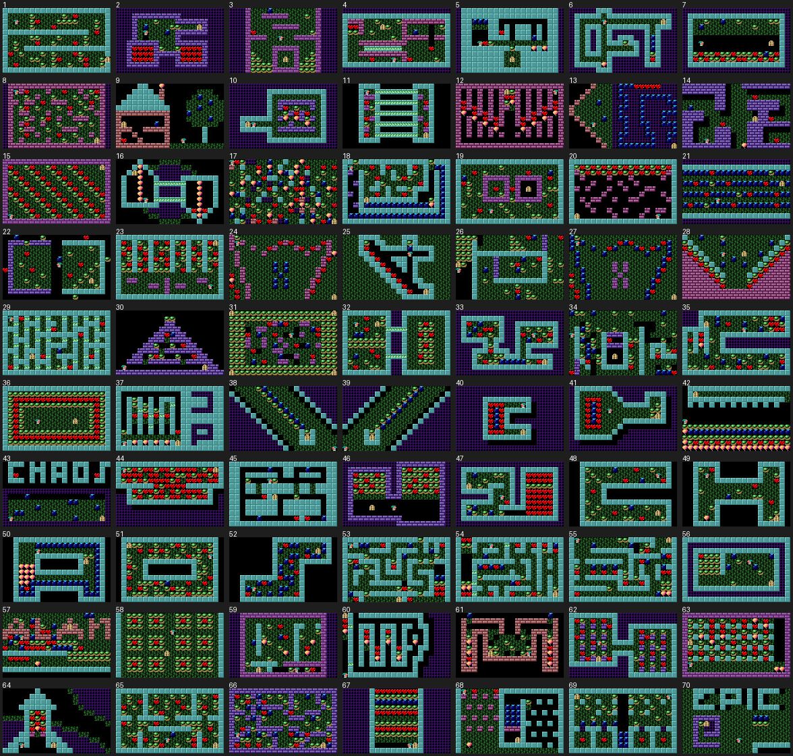
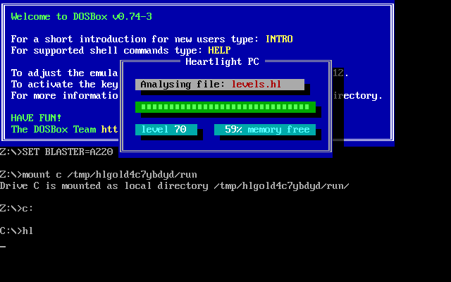
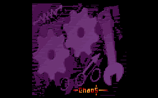
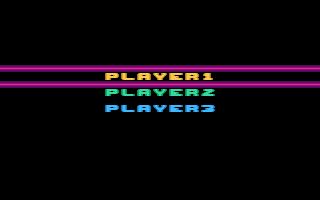
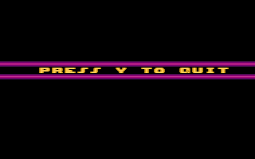
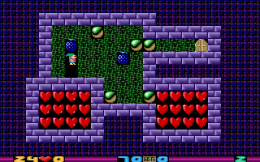
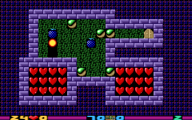

# 4. Game content

## 4.1 The game

Heartlight is a *Boulder Dash*-style puzzle game played on single-screen 20×12 levels. The player
guides a dwarf (with a green hat) who must collect **every heart** of the level; the exit door
then opens and he walks out to the next level. Rocks, hearts and bombs fall and roll, balloons
rise, bombs explode, and the dwarf dies if something falls on him. There is no time limit, no
score and no life counter: Esc restarts the level, and the level also restarts by itself after
the dwarf has died. Levels can be played in any order (Space + ←/→), and each of the three
player slots remembers which levels it has solved.

The objects are described with their exact rules in [03-engine.md](03-engine.md).

| object | char | in short |
|---|---|---|
| dwarf | `*` | walks, digs grass, pushes rocks/bombs/balloons sideways, collects hearts |
| heart | `$` | must all be collected; falls and rolls like a rock |
| rock | `@` | falls, rolls off round things, kills the dwarf from above |
| grass | `.` | earth: holds things up, the dwarf digs it away, nothing rolls off it |
| exit door | `!` | opens when no hearts are left |
| bomb | `&` | falls like a rock and explodes when it lands on anything but grass or is hit or reached by an explosion; destroys the 4 neighbours (not metal walls or tunnels) and lights other bombs |
| balloon | `0` | rises, lifting one object; two stacked weights push it down |
| plasma | `=` | animated wall; things roll off it, explosions destroy it |
| brick wall | `#` | wall; things roll off it; explosions destroy it |
| metal wall | `%` | indestructible wall; things do not roll off it |
| tunnel | `<` `>` | one-way passage the dwarf can walk through in its direction only |

## 4.2 The 70 levels

`LEVELS.HL` of the 2006 release holds 70 levels (the format allows 199). Authors: Janusz Pelc 61, Marek Kubowicz 3, Maciej Janiec 3, Maciej Mach 1, Marek Kubas 1, Jacek Aleksandrow 1.
Totals: 787 hearts, 1281 rocks, 519 bombs, 125 balloons, 1934 plasma cells, 111 tunnel cells.

| # | author | hearts | rocks | bombs | balloons | plasma | tunnel cells | dwarfs | doors | |
|---|---|---|---|---|---|---|---|---|---|---|
| 1 | Janusz Pelc | 12 | 31 | 0 | 0 | 0 | 0 | 1 | 1 | [png](../../assets/levels/png/level_01.png) |
| 2 | Janusz Pelc | 24 | 5 | 2 | 0 | 111 | 0 | 1 | 1 | [png](../../assets/levels/png/level_02.png) |
| 3 | Janusz Pelc | 1 | 22 | 1 | 0 | 72 | 0 | 1 | 1 | [png](../../assets/levels/png/level_03.png) |
| 4 | Janusz Pelc | 5 | 9 | 1 | 0 | 40 | 7 | 1 | 1 | [png](../../assets/levels/png/level_04.png) |
| 5 | Janusz Pelc | 2 | 2 | 4 | 2 | 24 | 0 | 1 | 1 | [png](../../assets/levels/png/level_05.png) |
| 6 | Janusz Pelc | 1 | 2 | 3 | 1 | 96 | 0 | 1 | 1 | [png](../../assets/levels/png/level_06.png) |
| 7 | Janusz Pelc | 12 | 24 | 3 | 0 | 60 | 0 | 1 | 1 | [png](../../assets/levels/png/level_07.png) |
| 8 | Janusz Pelc | 11 | 20 | 0 | 0 | 24 | 0 | 1 | 1 | [png](../../assets/levels/png/level_08.png) |
| 9 | Janusz Pelc | 1 | 0 | 6 | 1 | 0 | 0 | 1 | 1 | [png](../../assets/levels/png/level_09.png) |
| 10 | Janusz Pelc | 3 | 3 | 0 | 3 | 115 | 0 | 1 | 1 | [png](../../assets/levels/png/level_10.png) |
| 11 | Janusz Pelc | 5 | 2 | 0 | 0 | 0 | 40 | 1 | 1 | [png](../../assets/levels/png/level_11.png) |
| 12 | Janusz Pelc | 18 | 2 | 0 | 9 | 0 | 0 | 1 | 1 | [png](../../assets/levels/png/level_12.png) |
| 13 | Janusz Pelc | 5 | 0 | 56 | 0 | 84 | 0 | 1 | 1 | [png](../../assets/levels/png/level_13.png) |
| 14 | Janusz Pelc | 4 | 0 | 1 | 1 | 0 | 0 | 1 | 1 | [png](../../assets/levels/png/level_14.png) |
| 15 | Janusz Pelc | 42 | 41 | 0 | 0 | 0 | 0 | 1 | 1 | [png](../../assets/levels/png/level_15.png) |
| 16 | Janusz Pelc | 2 | 0 | 0 | 14 | 38 | 12 | 1 | 1 | [png](../../assets/levels/png/level_16.png) |
| 17 | Marek Kubowicz | 21 | 22 | 15 | 21 | 12 | 0 | 1 | 1 | [png](../../assets/levels/png/level_17.png) |
| 18 | Janusz Pelc | 8 | 9 | 40 | 1 | 0 | 0 | 1 | 1 | [png](../../assets/levels/png/level_18.png) |
| 19 | Janusz Pelc | 8 | 20 | 2 | 0 | 0 | 0 | 1 | 1 | [png](../../assets/levels/png/level_19.png) |
| 20 | Janusz Pelc | 17 | 17 | 0 | 0 | 0 | 0 | 1 | 1 | [png](../../assets/levels/png/level_20.png) |
| 21 | Janusz Pelc | 11 | 4 | 64 | 0 | 40 | 0 | 1 | 1 | [png](../../assets/levels/png/level_21.png) |
| 22 | Janusz Pelc | 6 | 16 | 2 | 0 | 0 | 0 | 1 | 1 | [png](../../assets/levels/png/level_22.png) |
| 23 | Janusz Pelc | 24 | 31 | 0 | 0 | 0 | 0 | 1 | 1 | [png](../../assets/levels/png/level_23.png) |
| 24 | Marek Kubowicz | 14 | 1 | 9 | 2 | 0 | 0 | 1 | 1 | [png](../../assets/levels/png/level_24.png) |
| 25 | Janusz Pelc | 9 | 2 | 1 | 0 | 0 | 0 | 1 | 1 | [png](../../assets/levels/png/level_25.png) |
| 26 | Maciej Mach | 5 | 38 | 5 | 0 | 0 | 0 | 1 | 1 | [png](../../assets/levels/png/level_26.png) |
| 27 | Marek Kubowicz | 14 | 2 | 31 | 0 | 0 | 0 | 1 | 1 | [png](../../assets/levels/png/level_27.png) |
| 28 | Janusz Pelc | 16 | 17 | 7 | 0 | 0 | 0 | 1 | 1 | [png](../../assets/levels/png/level_28.png) |
| 29 | Janusz Pelc | 8 | 1 | 1 | 0 | 0 | 33 | 1 | 1 | [png](../../assets/levels/png/level_29.png) |
| 30 | Janusz Pelc | 4 | 7 | 1 | 0 | 0 | 0 | 1 | 1 | [png](../../assets/levels/png/level_30.png) |
| 31 | Janusz Pelc | 10 | 124 | 7 | 0 | 0 | 0 | 1 | 4 | [png](../../assets/levels/png/level_31.png) |
| 32 | Janusz Pelc | 10 | 40 | 3 | 0 | 20 | 8 | 1 | 1 | [png](../../assets/levels/png/level_32.png) |
| 33 | Janusz Pelc | 10 | 14 | 9 | 0 | 102 | 0 | 1 | 1 | [png](../../assets/levels/png/level_33.png) |
| 34 | Marek Kubas | 8 | 25 | 12 | 0 | 0 | 0 | 1 | 1 | [png](../../assets/levels/png/level_34.png) |
| 35 | Janusz Pelc | 13 | 21 | 10 | 1 | 33 | 0 | 1 | 1 | [png](../../assets/levels/png/level_35.png) |
| 36 | Janusz Pelc | 44 | 88 | 0 | 0 | 0 | 0 | 1 | 1 | [png](../../assets/levels/png/level_36.png) |
| 37 | Janusz Pelc | 5 | 6 | 0 | 4 | 21 | 5 | 1 | 1 | [png](../../assets/levels/png/level_37.png) |
| 38 | Janusz Pelc | 0 | 9 | 8 | 0 | 83 | 0 | 1 | 1 | [png](../../assets/levels/png/level_38.png) |
| 39 | Janusz Pelc | 0 | 9 | 8 | 0 | 83 | 0 | 1 | 1 | [png](../../assets/levels/png/level_39.png) |
| 40 | Janusz Pelc | 14 | 0 | 4 | 0 | 157 | 0 | 1 | 1 | [png](../../assets/levels/png/level_40.png) |
| 41 | Janusz Pelc | 14 | 4 | 4 | 0 | 91 | 0 | 1 | 1 | [png](../../assets/levels/png/level_41.png) |
| 42 | Janusz Pelc | 9 | 50 | 19 | 22 | 0 | 0 | 1 | 1 | [png](../../assets/levels/png/level_42.png) |
| 43 | Janusz Pelc | 2 | 0 | 10 | 0 | 50 | 0 | 1 | 1 | [png](../../assets/levels/png/level_43.png) |
| 44 | Janusz Pelc | 56 | 22 | 0 | 0 | 70 | 0 | 1 | 1 | [png](../../assets/levels/png/level_44.png) |
| 45 | Janusz Pelc | 3 | 3 | 4 | 0 | 0 | 0 | 1 | 1 | [png](../../assets/levels/png/level_45.png) |
| 46 | Janusz Pelc | 14 | 45 | 0 | 0 | 47 | 0 | 1 | 1 | [png](../../assets/levels/png/level_46.png) |
| 47 | Janusz Pelc | 36 | 13 | 4 | 0 | 72 | 0 | 1 | 1 | [png](../../assets/levels/png/level_47.png) |
| 48 | Janusz Pelc | 6 | 16 | 3 | 0 | 0 | 0 | 1 | 1 | [png](../../assets/levels/png/level_48.png) |
| 49 | Janusz Pelc | 4 | 10 | 1 | 1 | 0 | 0 | 1 | 1 | [png](../../assets/levels/png/level_49.png) |
| 50 | Janusz Pelc | 1 | 2 | 40 | 11 | 0 | 0 | 1 | 1 | [png](../../assets/levels/png/level_50.png) |
| 51 | Janusz Pelc | 16 | 50 | 1 | 0 | 0 | 0 | 1 | 1 | [png](../../assets/levels/png/level_51.png) |
| 52 | Janusz Pelc | 8 | 0 | 25 | 0 | 0 | 0 | 1 | 1 | [png](../../assets/levels/png/level_52.png) |
| 53 | Maciej Janiec | 11 | 14 | 9 | 0 | 0 | 0 | 1 | 1 | [png](../../assets/levels/png/level_53.png) |
| 54 | Maciej Janiec | 14 | 10 | 6 | 2 | 0 | 4 | 1 | 1 | [png](../../assets/levels/png/level_54.png) |
| 55 | Maciej Janiec | 12 | 13 | 9 | 2 | 0 | 0 | 1 | 1 | [png](../../assets/levels/png/level_55.png) |
| 56 | Janusz Pelc | 1 | 18 | 4 | 0 | 52 | 0 | 1 | 1 | [png](../../assets/levels/png/level_56.png) |
| 57 | Jacek Aleksandrow | 18 | 28 | 13 | 1 | 0 | 0 | 1 | 1 | [png](../../assets/levels/png/level_57.png) |
| 58 | Janusz Pelc | 12 | 96 | 0 | 0 | 0 | 0 | 1 | 1 | [png](../../assets/levels/png/level_58.png) |
| 59 | Janusz Pelc | 4 | 10 | 2 | 4 | 48 | 0 | 1 | 1 | [png](../../assets/levels/png/level_59.png) |
| 60 | Janusz Pelc | 8 | 2 | 0 | 6 | 43 | 2 | 1 | 1 | [png](../../assets/levels/png/level_60.png) |
| 61 | Janusz Pelc | 3 | 11 | 2 | 6 | 0 | 0 | 1 | 1 | [png](../../assets/levels/png/level_61.png) |
| 62 | Janusz Pelc | 17 | 15 | 0 | 0 | 54 | 0 | 1 | 1 | [png](../../assets/levels/png/level_62.png) |
| 63 | Janusz Pelc | 25 | 32 | 0 | 8 | 0 | 0 | 1 | 1 | [png](../../assets/levels/png/level_63.png) |
| 64 | Janusz Pelc | 6 | 5 | 0 | 1 | 65 | 0 | 1 | 1 | [png](../../assets/levels/png/level_64.png) |
| 65 | Janusz Pelc | 17 | 42 | 1 | 0 | 0 | 0 | 1 | 1 | [png](../../assets/levels/png/level_65.png) |
| 66 | Janusz Pelc | 13 | 29 | 13 | 0 | 0 | 0 | 1 | 1 | [png](../../assets/levels/png/level_66.png) |
| 67 | Janusz Pelc | 24 | 32 | 8 | 0 | 120 | 0 | 1 | 1 | [png](../../assets/levels/png/level_67.png) |
| 68 | Janusz Pelc | 2 | 1 | 12 | 1 | 0 | 0 | 1 | 1 | [png](../../assets/levels/png/level_68.png) |
| 69 | Janusz Pelc | 4 | 18 | 10 | 0 | 4 | 0 | 1 | 1 | [png](../../assets/levels/png/level_69.png) |
| 70 | Janusz Pelc | 0 | 4 | 3 | 0 | 3 | 0 | 1 | 1 | [png](../../assets/levels/png/level_70.png) |

Notes:

* Levels 38, 39 and 70 have **no hearts**: the door is open from the first tick and the puzzle is
  only to reach it.
* Level 30 is the only one that kills a dwarf who does not move: the two rocks on top of the
  pyramid roll down and fall on him on tick 23 (2.6 s).
* Some levels are pictures: 9 (a house and a tree), 43 (the word **CHAOS**, like the start-up
  picture), 70 (the word **EPIC**, for Epic MegaGames).
* Every level has exactly one dwarf. Level 31 has **four doors** (all open together; any of them
  ends the level); all others have one. The engine accepts several dwarfs too (each moves with
  the same input).
* Cells outside the walls are often filled with plasma, metal or grass for looks; the metal
  border of the 22×14 grid keeps everything inside the 20×12 field.

The levels are also in [`assets/levels/`](../../assets/levels/): `levels.json` (rows, author,
counts), one PNG per level and Tiled maps (`tiled/level_NN.tmj` with the tileset
`sprites/heartlight.tsj`).

## 4.3 Screens

| | |
|---|---|
|  | **Start-up** (text mode): the "Analysing file: levels.hl" window with a progress bar, the level count and free memory, while `LEVELS.HL` is parsed. |
|  | **Chaos** picture (`chaos.ggs`), faded in while the sprites and sounds load. |
|  | **Title**: the logo, the current player's name at the bottom right, and credit pages that rotate above it ("programmed, graphics and music by Janusz Pelc"; "support: Maciej Miąsik, Paweł Wyrzycki, Marek Kubowicz"; "creative commons release 2006"). The title tune loops. |
|  | **Enter**: choose one of three players (↑/↓, Enter) and type a new name. |
|  | **Esc / F10** on the title: "press y to quit". |
|  | **Play**: the level and the status line (hearts in level ♥ collected, levels in file ♥/✓ solved, level number); option icons top-left for a few seconds. |
|  | **F1**: the overview map in 8×8 tiles, drawn over the title picture. |
|  | **Space + →**: the next level slides in. |
|   | **Esc**: the dwarf blinks (facing the player) and explodes; the level then restarts with a fade. |

## 4.4 Credits (from the title screen and `README.TXT`)

* Programmed by, graphics and music by: Janusz Pelc
* Support: Maciej Miąsik, Paweł Wyrzycki, Marek Kubowicz
* Levels by: Janusz Pelc, Marek Kubowicz, Maciej Janiec, Maciej Mach, Marek Kubas, Jacek Aleksandrow
* Creative Commons release 2006 (recompiled from the original sources by Maciej Miąsik)
