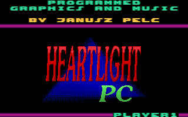
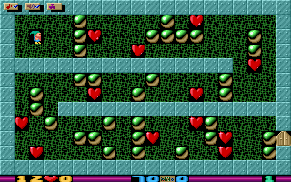
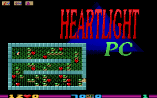

# Heartlight PC (DOS, 1994 / CC release 2006) — reverse-engineering notes

Reverse engineering of **Heartlight PC** by Janusz Pelc / Xland (published by Epic MegaGames in
1994, released under CC BY-SA 2.5 in 2006), done as groundwork for a modern remake. The game was
analysed from the release files (`HL.EXE`, `LEVELS.HL`, `CONFIG.EXE`) by disassembling the
16-bit Borland C++ executable and checking every rule against the original running in DOSBox.

| document | contents |
|---|---|
| [01-executable.md](01-executable.md) | binary layout, segments, program flow, anti-debugging, video and sound drivers, globals, how to reproduce |
| [02-file-formats.md](02-file-formats.md) | the encrypted LZ resource volume inside `HL.EXE`, GGS sprites, palette, sounds, music sequence, `LEVELS.HL`, `CONFIG.DTA`, player files |
| [03-engine.md](03-engine.md) | the grid, the tick and scan order, every object's rules (dwarf, falling/rolling, bombs, explosions, balloons, door, plasma, tunnels), input, drawing, sound, timing, verification |
| [04-game-content.md](04-game-content.md) | objects in short, the 70 levels, screens, credits |
| [05-remake-guide.md](05-remake-guide.md) | how to port, fidelity checklist, testing against the original, presentation ideas, open questions, licence |
| [06-history.md](06-history.md) | Atari original, Xland, Epic MegaGames, the 2006 CC release |

## Quick facts

* One 20×12 level per screen (16×16 cells, 320×192 + an 8-pixel status line), VGA 320×200×256
  Mode X, one palette.
* 14 object types in a 22×14 byte grid (the level plus a metal border); 9 handlers run in a
  top-to-bottom, left-to-right scan once per **tick of 112.6 ms (8.88 Hz)**; every object moves
  at most one cell per tick. Nothing in the logic is random.
* 63 sprites (16×16 + 8×8 overview copies), a 16×8 three-colour font, two pictures, 13 sound
  effects and a 6½-minute tune assembled from 20 two-second blocks, all 8-bit PCM at 8 523 Hz,
  stored in an XOR-encrypted, LZ-packed volume appended to `HL.EXE`.
* 70 levels in plain text (`LEVELS.HL`, up to 199), by six authors.
* Borland C++ 3.x, large model, 286+, drivers for VGA/VGA mono and PC speaker, Sound Blaster,
  AdLib, LPT DAC.
* The rules are re-implemented in `tools/hl_sim.py` and match the original on all 70 levels,
  idle and with move sequences (3.14).

| title | play | overview (F1) |
|---|---|---|
|  |  |  |

## Tools (in `tools/`)

| tool | purpose |
|---|---|
| `extract_assets.py` | everything to PNG/WAV/JSON/Tiled (`python3 tools/extract_assets.py original/ assets/`) |
| `hl_volume.py` | list / extract the resource volume of `HL.EXE` |
| `hl_gfx.py` | GGS sprite reader, palette |
| `hl_levels.py` | `LEVELS.HL` parser with the original's rules |
| `hl_sim.py` | **the game rules**, ported routine by routine from segment `1633` |
| `screen_reader.py` | reads the play-field back from a DOSBox screenshot |
| `golden_check.py` | plays the original in DOSBox and checks every frame against `hl_sim.py` |
| `make_scenarios.py` | builds the move scenarios used by `golden_check.py` |
| `mz_loader.py` | MZ loader (relocations, overlay) |
| `disasm.py` | annotated disassembly (capstone) with switch tables, symbols, grid accesses |
| `symbols.txt` | recovered names of functions and variables |

Requirements: Python 3.9+, `pip install -r tools/requirements.txt` (Pillow, capstone). The
golden check also needs DOSBox, Xvfb and xdotool.
