# Heartlight: Revibed — the Godot 4 remake

Work in progress, following [the plan](../docs/remake-plan.md). **M7 done — first release**: all 70 levels with
the original's rules (tick for tick), graphics (pixel for pixel), sounds and music; title, pause,
options, controls with remapping, level select, three players with saving, credits, Polish and
English; a web build (installable as an app, PWA) with touch controls for phones, held sideways or
upright; side panels on wide screens, smooth movement, undo and other level files (options, all off
or as the original by default); a level editor that saves files the original game plays.

| title | level select | play |
|---|---|---|
| 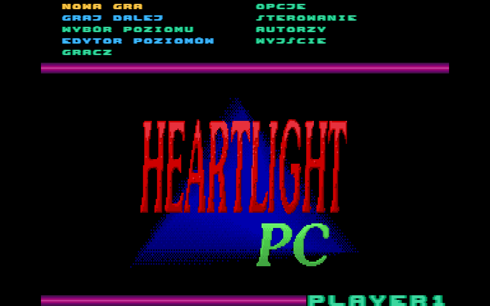 | 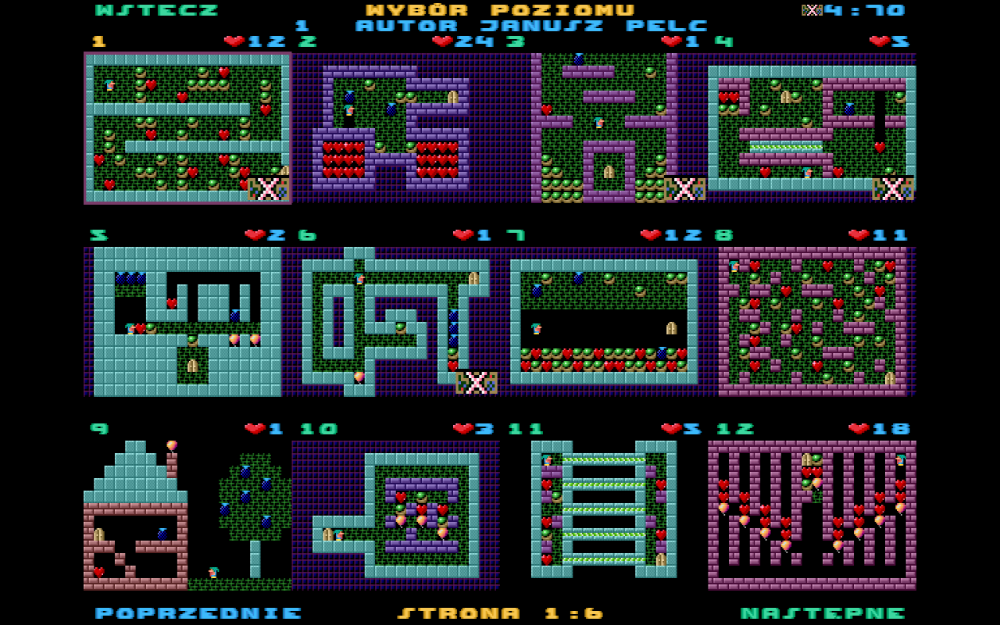 | 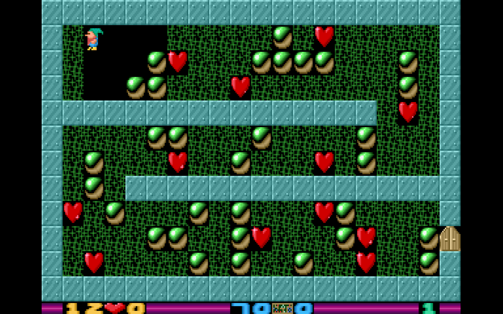 |
| options | controls | pause |
| 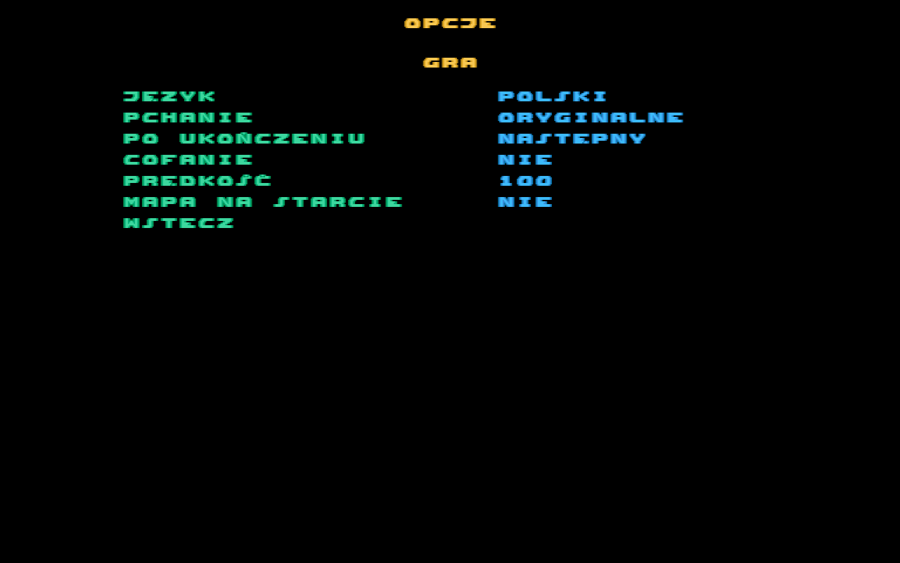 | 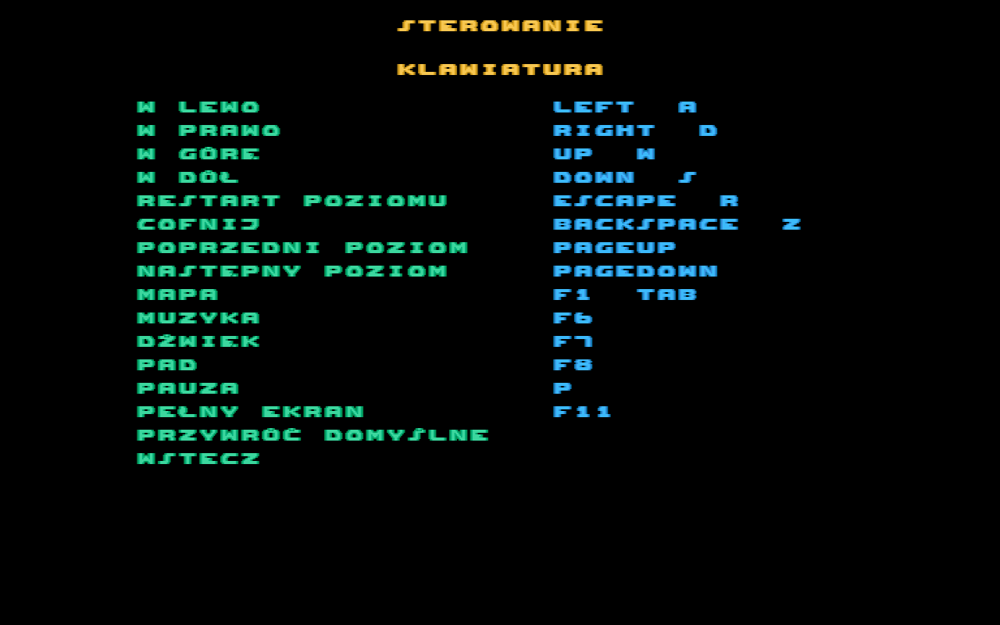 | 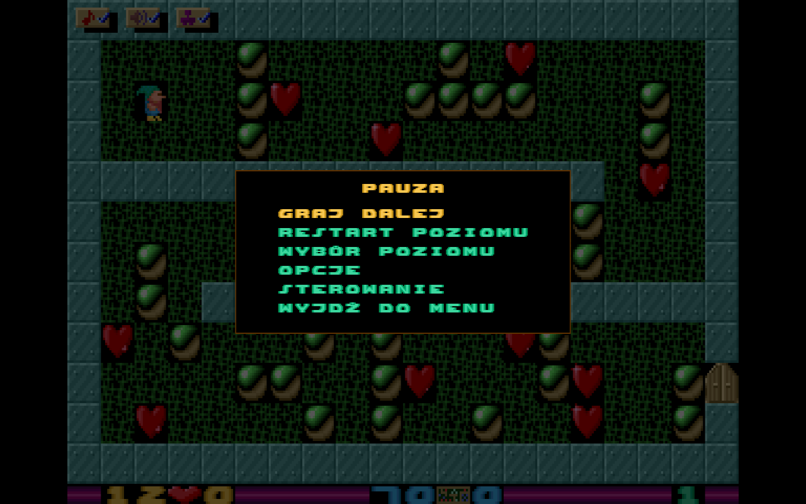 |

| phone, sideways | phone, upright |
|---|---|
| 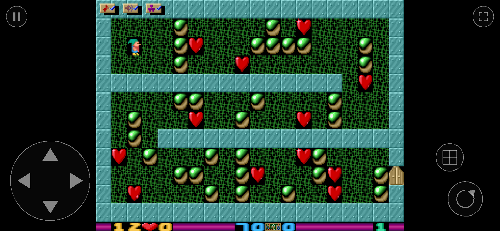 | 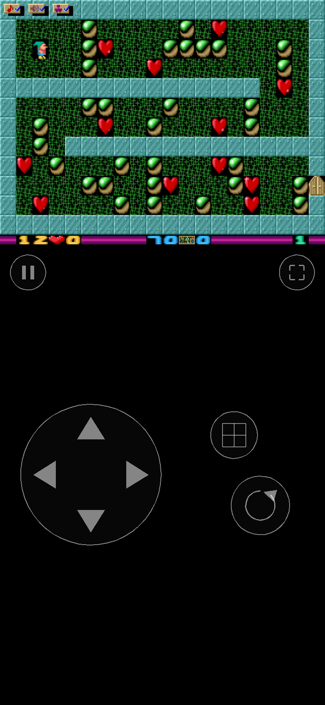 |

Wide screen (option *szeroki ekran*): the level number, author, hearts, solved levels and the
option icons beside the picture.

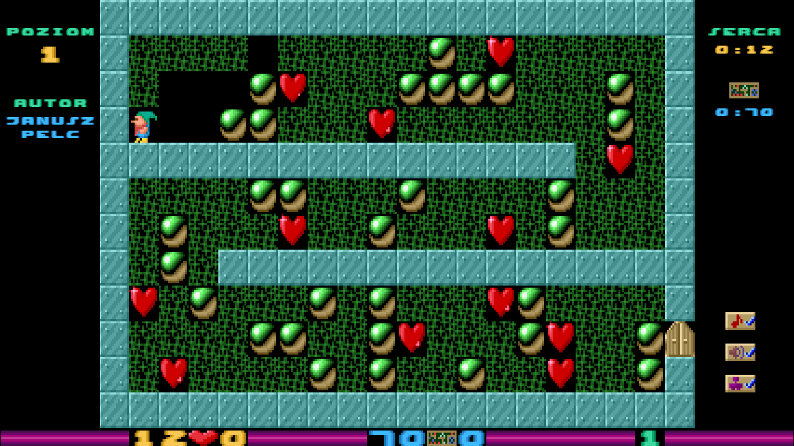

## Level editor

EDYTOR POZIOMÓW on the title (or E / gamepad X on a level in WYBÓR POZIOMU).

| editing | editor menu |
|---|---|
| 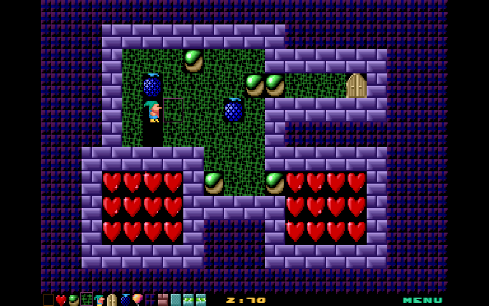 | 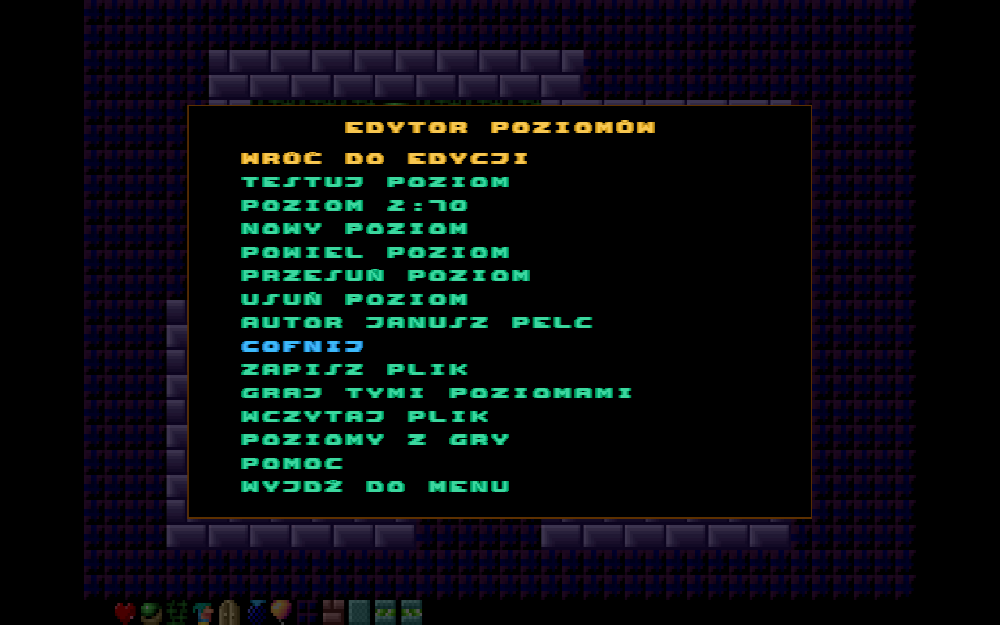 |

* The level with a cursor; below it the 13 objects (the original's small sprites) and the level
  number. Keyboard: arrows move, Space puts the object, the level file's own characters
  (`$ @ . * ! & 0 = # % < >`) choose and put that object, Delete clears, Q/E/Tab change the
  object, Z undoes, PgUp/PgDn change the level, T tests, F1 help, Esc menu. Mouse and touch: drag
  to paint, right button picks the object under it, tap an object or MENU below. Gamepad: d-pad,
  A puts, LB/RB object, X picks, Y tests, Start menu.
* Menu: test the level (its end, F10 or the pause menu come back), go to / add / duplicate /
  move / delete levels, author, undo, save, play the whole file, open a file, take the game's
  levels, help.
* Before testing, saving or playing, the file is checked with the original parser's rules and
  messages (a dwarf, a door, 12 rows, fewer than 199 levels); the editor jumps to the level.
* Saving writes a standard `LEVELS.HL` (the original's legend header, `author:` lines, CR LF, ^Z):
  desktop asks where (file dialog), the web downloads it. The work in progress is kept in
  `user://editor.json`. A saved file was checked in the original game in DOSBox
  ([`tests/editor_file/`](../tests/editor_file/README.md)).

## Playing

In the browser: <https://mbialkowski.github.io/heartlight-revibed/> (published from `main` by CI).


`godot --path remake` (Godot 4.7.2); `-- --level=N` starts playing level N at once.

Default keys (all remappable in STEROWANIE / CONTROLS):

| action | keyboard | gamepad |
|---|---|---|
| move / push | arrows, WASD | d-pad, left stick |
| restart the level (the original's Esc) | Esc, R | Back |
| undo (option *cofanie*, off by default) | Backspace, Z | LB |
| previous / next level | Space + ←/→, PgUp / PgDn | |
| overview map | F1, Tab | Y |
| music / sound / gamepad on-off | F6 / F7 / F8 | |
| pause menu | P | Start |
| back to the title | F10 | |
| full screen | F11 | |

Menus: arrows/WASD, Enter/Space, Esc/Backspace; gamepad d-pad/stick, A, B; mouse and touch.
Touch (shown automatically on touch screens; STEROWANIE → DOTYK sets it on/off, size, opacity and
left/right-handed layout): a 4-way pad, restart, undo (with the option), map, pause, full screen.

Other levels: OPCJE → GRA → *plik poziomów* opens a `LEVELS.HL` (desktop: file dialog; web: file
picker), or drop the file on the window. It is checked with the original's rules and messages, kept
in `user://custom_levels.hl` until *wróć do oryginalnych poziomów*; progress is kept per file.

Settings are saved in `user://settings.cfg`, the players in `user://players.json`.

Texts use only the characters of the original's font (a–z, Polish letters, digits, `:` `.`), drawn
on a 640x400 layer over the 320x200 screen: the original's glyphs at half size, 40 per line.

## What is here

| path | what |
|---|---|
| `data/` | **generated** by `tools/build_remake_data.py` (index-image sprites/font/pictures, palette, levels, sounds, music blocks, `game.json`) and `tools/make_golden_traces.py` (`golden_traces.json`); never edit by hand |
| `scripts/sim/sim.gd` | the rules: a line-by-line port of `tools/hl_sim.py` (itself a port of `HL.EXE` segment 1633, verified against the original in DOSBox on all 70 levels) |
| `scripts/sim/levels.gd` | `LEVELS.HL` parser with the original's rules and error messages |
| `scripts/sim/rand.gd` | Borland `rand()` (start frames of hearts/balloons, heart-landing sound) |
| `scripts/game/data.gd` | autoload `Data`: loads the bundle |
| `scripts/game/audio.gd` | the original's two channels: music loop (197 blocks) and effects |
| `scripts/game/settings.gd` | options, bindings (swap on conflict, defaults), input map |
| `scripts/game/progress.gd` | three players, solved levels per level file, current level |
| `scripts/game/strings.gd` | Polish and English texts |
| `scripts/game/level_set.gd` | the editor's levels: painting, undo, add/move/delete, the original's checks, LEVELS.HL writing |
| `scripts/view/text_layer.gd` | the 640x400 menu layer |
| `scripts/view/screen.gd` | the 320x200 screen in palette indices: cells, status line, icons, overview |
| `scripts/view/touch.gd` | on-screen pad and buttons (multi-touch) |
| `scripts/view/palette.gd`, `palette.gdshader` | palette (fades, VGA mono) and sharp-bilinear scaling |
| `scripts/main.gd` | the screens and the play loop (tick, restart fade, level slide, undo), side panels, level files |
| `tests/` | `check.gd` (scripts parse, data present), `rules.gd` (single rules, as `tests/test_sim.py`), `golden.gd` (280 traces, 91 000 ticks: state hash, sounds and grids every tick), `solutions.gd` (recorded solutions of 32 levels, found by `tools/solve_levels.py`, must still finish them; the other levels are play-tested), `scenarios.gd` (103 checks: menus, options, remapping, players, saving, undo, level change, smooth movement, side panels, level files, the editor, PLAYER?.STT import), `web_smoke.mjs` (loads the web build in Chromium as desktop, phone sideways and upright, and wide with a dropped level file, opens the editor and paints, plays by keys and touch, saves screenshots), `render_dump.gd` (renders screens for `tools/compare_render.py`, which compares them with the original's screenshot: 0 differing pixels) |

## Running the tests

```bash
python3 tools/build_remake_data.py original/ remake/data/          # after changing the converter
python3 tools/make_golden_traces.py original/LEVELS.HL tests/golden_scenarios.json remake/data/golden_traces.json
godot --headless --path remake --import
godot --headless --path remake --script res://tests/check.gd
godot --headless --path remake --script res://tests/rules.gd
godot --headless --path remake --script res://tests/golden.gd
```

CI (`.github/workflows/remake.yml`) runs the Python tests, checks that `remake/data` is up to date,
runs the Godot tests, compares the rendered level 1 with the original's screenshot, exports the web
build (`export_presets.cfg`, preset `Web`, single-threaded so it needs no special headers), runs the
web smoke test and, on `main`, publishes the build on GitHub Pages. Godot 4.7.2.

Web build locally:

```bash
mkdir -p remake/build/web && touch remake/build/.gdignore
godot --headless --path remake --export-release Web build/web/index.html
node remake/tests/web_smoke.mjs remake/build/web /tmp/web-shots    # needs playwright
```

## Licence

The remake's code is MIT. `data/` is converted from Heartlight PC and, like the game, licensed
under Creative Commons Attribution-ShareAlike 2.5 (credits in the main README).

## Releases

Push a tag `v*` (e.g. `git tag v1.0.0 && git push origin v1.0.0`): `.github/workflows/release.yml`
tests the project and attaches `heartlight-revibed-<tag>-linux.zip`, `-windows.zip` and `-web.zip`
to a GitHub release. Locally: presets `Linux`, `Windows` and `Web` in `export_presets.cfg`.
